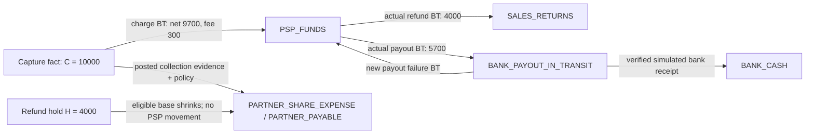
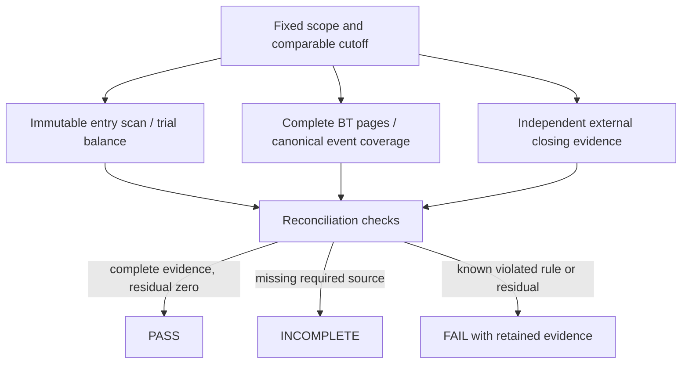

# Accounting: facts, entries and seven invariants

[English index](README.md) · [Frozen accounting examples](../ledger/posting-examples.md)

The example below uses **synthetic USD minor units**: capture 10000, actual fee 300, refund 4000, partner rate 2000 basis points, payout 5700. These are fixture inputs and hand calculations, not measured revenue, fees or production volume. [BTJournalMapper.java:16](../../src/main/java/com/paymentsledger/financialingestion/BTJournalMapper.java#L16), [RevenueShareService.java:167](../../src/main/java/com/paymentsledger/revenueshare/RevenueShareService.java#L167), [PayoutService.java:98](../../src/main/java/com/paymentsledger/payout/PayoutService.java#L98) and [BankMatcher.java:135](../../src/main/java/com/paymentsledger/bank/BankMatcher.java#L135) implement the respective boundaries. Existing local tests are indexed in the [acceptance audit](acceptance-evidence-audit.md); PR20's six selected demo branches passed in the [archived local replay](../evidence/pr20/verified-all-result.json), with simulated bank evidence and persistent Fake provider state.



| Fact | Debit | Credit | What must not be inferred |
|---|---|---|---|
| Capture BT | PSP_FUNDS 9700; PSP_FEE_EXPENSE 300 | SALES_REVENUE 10000 | Session creation is not capture |
| Initial internal share | PARTNER_SHARE_EXPENSE 2000 | PARTNER_PAYABLE 2000 | Accrual is not a partner payment |
| Refund reservation | PARTNER_PAYABLE 800 | PARTNER_SHARE_EXPENSE 800 | H=4000 does not reduce PSP cash |
| Refund debit BT | SALES_RETURNS 4000 | PSP_FUNDS 4000 | UNKNOWN alone cannot create this BT |
| Payout debit BT | BANK_PAYOUT_IN_TRANSIT 5700 | PSP_FUNDS 5700 | `paid` alone does not confirm bank cash |
| Bank receipt fixture | BANK_CASH 5700 | BANK_PAYOUT_IN_TRANSIT 5700 | A bank connection was not exercised |

The mapper uses signed provider facts directly. These copied lines are from [BTJournalMapper.java:17](../../src/main/java/com/paymentsledger/financialingestion/BTJournalMapper.java#L17):

```java
        add(lines,accounts,"PSP_FUNDS",fact.netMinor());
        switch(kind) {
            case CHARGE -> {add(lines,accounts,"PSP_FEE_EXPENSE",fact.feeMinor());add(lines,accounts,"SALES_REVENUE",Math.negateExact(fact.amountMinor()));}
```

A definitive early refund failure releases H and may restore share when all eligibility guards hold. If there was no debit BT, no debit/return pair is manufactured. If a debit did occur, a separate failure-return BT creates a separate journal. Original charge fees remain unless actual fee-return evidence says otherwise.

Dispute accounting is also evidence-driven: an actual debit BT records receivable and actual fee; `lost` transfers remaining receivable to loss without debiting PSP again. A late win return allocates to remaining receivable, then prior loss, then excess Suspense. Inquiry or warning without a debit BT cannot fabricate a PSP debit. [PR13](../evidence/pr13/README.md) documents tested local branches.

## Seven invariants, two kinds of proof

| Invariant | Commit boundary | Independent verification |
|---|---|---|
| I-01: balanced, sealed journals | [V3 final journal check](../../src/main/resources/db/migration/V3__immutable_ledger.sql#L140) and [construction guards](../../src/main/resources/db/migration/V3__immutable_ledger.sql#L121) | Scan all sealed entries and total debits/credits |
| I-02: canonical event has one journal | Stable event identity and atomic [post_ledger](../../src/main/resources/db/migration/V3__immutable_ledger.sql#L187) | Check accepted event→journal and journal→accepted event coverage |
| I-03: NORMAL refund capacity | [RefundIntentService:80](../../src/main/java/com/paymentsledger/payment/RefundIntentService.java#L80): locked payment/control, `0 <= R + H <= C` | Recompute capture, refunds, holds and unresolved aging |
| I-04: share cap | [RevenueShareService:167](../../src/main/java/com/paymentsledger/revenueshare/RevenueShareService.java#L167): snapshotted policy, cumulative floor cap, atomic adjustments | Independent floor arithmetic and adjustment coverage |
| I-05: PSP conservation | One accepted BT, one accounting effect | Same scope/cutoff: opening + complete BTs, ledger and independent closing evidence |
| I-06: payout conservation | [BankMatcher:72](../../src/main/java/com/paymentsledger/bank/BankMatcher.java#L72) locks payout and line; [BankMatchRules:82](../../src/main/java/com/paymentsledger/bank/domain/BankMatchRules.java#L82) enforces bank-line capacity | Principal = transit + net confirmed bank principal + confirmed returns; fees separate, completeness required |
| I-07: scope and rebuild | Scoped accounts, foreign keys and controlled posting | [BalanceRebuildService:86](../../src/main/java/com/paymentsledger/ledger/BalanceRebuildService.java#L86): independent entry scan versus projection; source-domain checks |

The [full invariant definitions](../ledger/invariants.md) explain why a unique key gives an upper bound on repeated posting but does not prove absence of missing events. Database commits enforce local constraints; they cannot prove Stripe/bank completeness. No end-to-end distributed exactly-once claim follows from this design.



An independent closing fixture of 900 with opening 0 and imported net 1000 produces residual 100/FAIL in [PR15](../evidence/pr15/README.md), even if local entries balance. The fixture closing is supplied independently and includes an omitted refund. Missing external closing evidence instead produces INCOMPLETE. Neither case authorizes an invented opening-equity or adjustment entry to hide the difference.

## Shareable diagram exports

[Money flow PNG](accounting-money-flow.png) · [Reconciliation evidence PNG](reconciliation-evidence-flow.png)

[Diagram verification](diagram-verification.json) records local Mermaid rendering only; it does not establish experimental acceptance.
