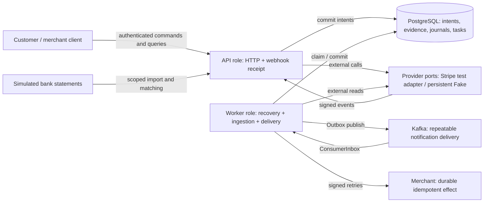
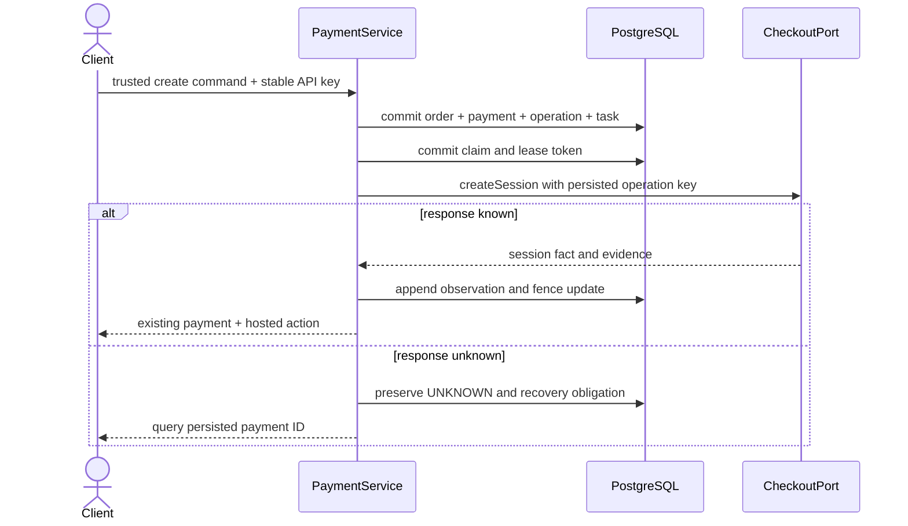
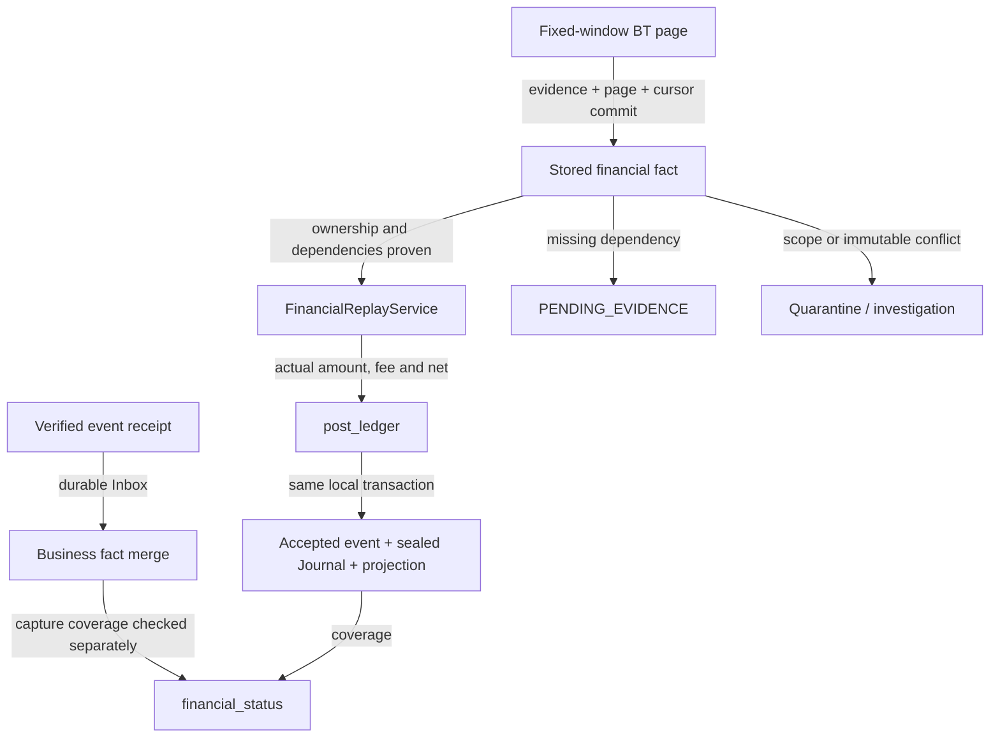

# Architecture through five execution paths

[English index](README.md) · Project baseline: `d92bae3`; source anchors checked in this PR20 worktree. Java line anchors below were checked against the source; experimental outcomes belong to their separate historical reports.

## Runtime shape



Each process must choose one role: [RunRoleConfig.java:39](../../src/main/java/com/paymentsledger/config/RunRoleConfig.java#L39) rejects a missing or ambiguous profile. [PaymentWorker.java:13](../../src/main/java/com/paymentsledger/payment/PaymentWorker.java#L13) polls recoverable operations; its L2 scan is separate. This is a modular monolith with two execution roles, not independent financial microservices.

PostgreSQL holds the durable truth and lock boundaries. Kafka supports repeated delivery; it is not the financial source of truth. Redis is declared in the broader project stack, but these traced fund paths do not depend on Redis for money correctness. See the documented choices in [immutable ledger ADR](../adr/0004-immutable-ledger.md), [unknown-result ADR](../adr/0003-provider-unknown-result.md) and [lock-order ADR](../adr/0007-lock-order-and-isolation.md).

## 1. Create a hosted payment

1. [AuthenticationFilter.java:69](../../src/main/java/com/paymentsledger/identity/AuthenticationFilter.java#L69) builds trusted application identity from the credential; scope checks reject forged organization/account inputs.
2. [PaymentController.java:20](../../src/main/java/com/paymentsledger/payment/PaymentController.java#L20) parses a create command using that trusted context. [PaymentService.java:14](../../src/main/java/com/paymentsledger/payment/PaymentService.java#L14) prepares the intent before executing it.
3. [PaymentRepository.java:77](../../src/main/java/com/paymentsledger/payment/PaymentRepository.java#L77) locks API-key and business-order identities, reads controlled price/policy snapshots and computes the authoritative minor-unit amount. At [line 101](../../src/main/java/com/paymentsledger/payment/PaymentRepository.java#L101), order, payment, provider operation, recovery obligation and API identity are persisted in one transaction.
4. [PaymentExecutor.java:36](../../src/main/java/com/paymentsledger/payment/PaymentExecutor.java#L36) obtains a committed claim and calls Checkout outside that transaction. At [line 49](../../src/main/java/com/paymentsledger/payment/PaymentExecutor.java#L49), a port exception becomes `TIMEOUT_UNKNOWN`, not a fabricated refusal.
5. [PaymentRepository.java:239](../../src/main/java/com/paymentsledger/payment/PaymentRepository.java#L239) records the response and fenced state transition. [PaymentService.java:31](../../src/main/java/com/paymentsledger/payment/PaymentService.java#L31) tells the caller to query the persisted resource when its outcome remains uncertain.



The call ordering is visible directly in [PaymentService.java:16](../../src/main/java/com/paymentsledger/payment/PaymentService.java#L16):

```java
        var intent=repository.prepare(context,key,request,executor.providerName());
        if(!intent.replay()){
            try{executor.execute(intent.operationId());}
```

`prepare` owns and finishes its local transaction before the executor starts external I/O. The durable task survives a crash in that gap.

Changing the price contract touches `PaymentRequests`, controlled configuration and `PaymentRepository.prepare`; changing response behavior touches `PaymentController` and `PaymentService`. A client-supplied price or a provider call moved inside the preparation transaction would break this boundary.

## 2. Recover an uncertain operation

[PaymentWorker.java:13](../../src/main/java/com/paymentsledger/payment/PaymentWorker.java#L13) → [OperationRecoveryCoordinator.java:19](../../src/main/java/com/paymentsledger/payment/OperationRecoveryCoordinator.java#L19) → [OperationLeaseService.java](../../src/main/java/com/paymentsledger/payment/OperationLeaseService.java) → [PaymentRepository.java:169](../../src/main/java/com/paymentsledger/payment/PaymentRepository.java#L169) is the claim chain. The coordinator then chooses the safe action at [line 45](../../src/main/java/com/paymentsledger/payment/OperationRecoveryCoordinator.java#L45): query a trusted external anchor first; execute an unsent prepared command; otherwise retry only with its original key inside the explicitly verified window. Unsafe or conflicting evidence is escalated at [line 53](../../src/main/java/com/paymentsledger/payment/OperationRecoveryCoordinator.java#L53).

This is a decision based on evidence, not “retry every exception.” [RecoveryPolicy.java:22](../../src/main/java/com/paymentsledger/payment/RecoveryPolicy.java#L22) defaults verified Fake retention to zero unless configured; a persisted expiry is not proof of provider retention. Old workers can append observations but cannot overwrite current control using an expired claim. [PR07 evidence](../evidence/pr07/README.md) and [PR19 F-05/F-06](../evidence/pr19/README.md) establish the local tested scope.

## 3. Receive business facts, then post financial facts

[StripeWebhookController.java:31](../../src/main/java/com/paymentsledger/webhook/StripeWebhookController.java#L31) reads exact raw bytes → [line 34](../../src/main/java/com/paymentsledger/webhook/StripeWebhookController.java#L34) verifies the bound endpoint → [WebhookInboxRepository.java](../../src/main/java/com/paymentsledger/webhook/WebhookInboxRepository.java) commits a receipt before the success response → [WebhookProcessor.java:30](../../src/main/java/com/paymentsledger/webhook/WebhookProcessor.java#L30) resolves scoped relationships asynchronously → [PaymentRepository.java:314](../../src/main/java/com/paymentsledger/payment/PaymentRepository.java#L314) merges confirmed attempts and capture. A failed attempt cannot erase an existing capture.

The money chain is separate: [FinancialImportService.java:44](../../src/main/java/com/paymentsledger/financialingestion/FinancialImportService.java#L44) fetches a fixed BT page outside a transaction, then commits evidence, page and cursor together → [FinancialReplayService.java:32](../../src/main/java/com/paymentsledger/financialingestion/FinancialReplayService.java#L32) validates dependencies and ownership → [BTJournalMapper.java:12](../../src/main/java/com/paymentsledger/financialingestion/BTJournalMapper.java#L12) maps actual signed amounts → [LedgerPostingService.java:24](../../src/main/java/com/paymentsledger/ledger/LedgerPostingService.java#L24) invokes the controlled posting function → [V3:187](../../src/main/resources/db/migration/V3__immutable_ledger.sql#L187) writes the accepted event, sealed journal, entries and projection atomically.



The scheduled importer uses [FinancialIngestionWorker.java:62](../../src/main/java/com/paymentsledger/financialingestion/FinancialIngestionWorker.java#L62) and [ImportWindows.java:11](../../src/main/java/com/paymentsledger/financialingestion/ImportWindows.java#L11): its OVERLAP covers completed business dates and ends at the current business day's midnight. Current-day BTs are outside that scheduled window. A performance experiment must report this behavior and any resulting queue or accounting lag; immediate HTTP acceptance cannot be counted as completed accounting throughput.

A new BT type changes classification, trusted source resolution and posting rules together. Merely adding a string to [FinancialEventNormalizer.java:10](../../src/main/java/com/paymentsledger/financialingestion/FinancialEventNormalizer.java#L10) does not establish business ownership.

## 4. Reserve a refund and confirm settlement

[RefundController.java:17](../../src/main/java/com/paymentsledger/payment/RefundController.java#L17) → [RefundRepository.java:37](../../src/main/java/com/paymentsledger/payment/RefundRepository.java#L37) → payment and refund-control locks at [line 49](../../src/main/java/com/paymentsledger/payment/RefundRepository.java#L49) → capacity check at [line 56](../../src/main/java/com/paymentsledger/payment/RefundRepository.java#L56) → reservation, operation and [RevenueShareService.reconcile at line 66](../../src/main/java/com/paymentsledger/revenueshare/RevenueShareService.java#L66) commit together → [RefundExecutor.java](../../src/main/java/com/paymentsledger/payment/RefundExecutor.java) invokes the provider afterward. A hold reduces eligibility, not PSP cash; refund BTs move cash separately.

For payout settlement, [FinancialReplayService.java:49](../../src/main/java/com/paymentsledger/financialingestion/FinancialReplayService.java#L49) → [PayoutService.java:42](../../src/main/java/com/paymentsledger/payout/PayoutService.java#L42) posts actual BTs into transit → [BankStatementImporter.java](../../src/main/java/com/paymentsledger/bank/BankStatementImporter.java) records simulated file evidence → [BankMatcher.java:26](../../src/main/java/com/paymentsledger/bank/BankMatcher.java#L26) locks payout and bank line, checks scope/reference/capacity → [line 46](../../src/main/java/com/paymentsledger/bank/BankMatcher.java#L46) builds cash/fee/transit entries → [line 57](../../src/main/java/com/paymentsledger/bank/BankMatcher.java#L57) separately evaluates evidence completeness. `paid` alone does not create bank cash.

## 5. Reconcile and recover a missing local payment

[ReconciliationService.java:34](../../src/main/java/com/paymentsledger/reconciliation/ReconciliationService.java#L34) fixes a business-day UTC window → [line 62](../../src/main/java/com/paymentsledger/reconciliation/ReconciliationService.java#L62) advances imports → [ReconciliationSourceRecovery.java:65](../../src/main/java/com/paymentsledger/payment/ReconciliationSourceRecovery.java#L65) reads BT→Charge→PI outside the transaction → [line 95](../../src/main/java/com/paymentsledger/payment/ReconciliationSourceRecovery.java#L95) checks a server-proven order and fences the claim before linking → [line 136](../../src/main/java/com/paymentsledger/payment/ReconciliationSourceRecovery.java#L136) reuses the canonical capture path → [ReconciliationService.java:75](../../src/main/java/com/paymentsledger/reconciliation/ReconciliationService.java#L75) freezes independent checks and evidence.

[BalanceRebuildService.java:49](../../src/main/java/com/paymentsledger/ledger/BalanceRebuildService.java#L49) reads immutable entries in a repeatable-read snapshot and compares them with projections. It does not use the production projection as its expected balance. Separately supplied closing evidence can reveal an omitted external BT even when local trial balance passes. Missing order, ambiguous metadata or amount mismatch yields observation/investigation; it must not manufacture an order or fulfillment.

**Inferred:** separating external reads from short local transactions limits lock duration during provider outages. The explicit `outsideTransaction` guards and committed obligations support this explanation; no production latency benefit is claimed.

## Shareable diagram exports

[Architecture PNG](architecture-overview.png) · [Create trace PNG](payment-create-trace.png) · [Financial ingestion PNG](financial-ingestion-flow.png)

[Diagram verification](diagram-verification.json) records local Mermaid rendering only; it does not establish experimental acceptance.
