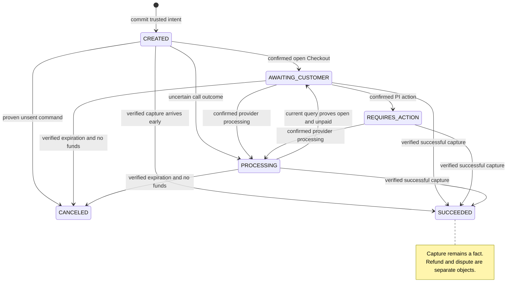
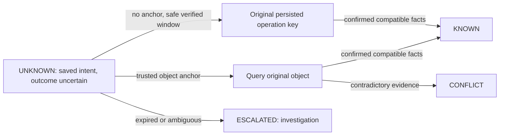

# Payment state follows evidence

[English index](README.md) · [Traced creation and recovery](architecture.md)

Four fields answer four different questions. [PaymentStateMerger.java:50](../../src/main/java/com/paymentsledger/payment/PaymentStateMerger.java#L50) calculates capture from preserved successful attempts and checks posted BT coverage separately; [PaymentEvidenceRules.java:169](../../src/main/java/com/paymentsledger/payment/domain/PaymentEvidenceRules.java#L169) calculates certainty; [PaymentReader.java:37](../../src/main/java/com/paymentsledger/payment/PaymentReader.java#L37) exposes the dimensions separately.

| Dimension | Field | Meaning |
|---|---|---|
| Business | `payment_status` | CREATED, AWAITING_CUSTOMER, REQUIRES_ACTION, PROCESSING, SUCCEEDED, CANCELED |
| Provider | `provider_status` | Original provider status, retained for explanation |
| Certainty | `resolution_status` | KNOWN, UNKNOWN, CONFLICT |
| Accounting | `financial_status` | NOT_APPLICABLE, PENDING_EVIDENCE, PARTIALLY_POSTED, POSTED, CONFLICT |

The diagram is a source-derived overview of evidence-driven transitions, not an exhaustive product-state certification. Session/query merging is implemented at [PaymentStateMerger.java:36](../../src/main/java/com/paymentsledger/payment/PaymentStateMerger.java#L36), timeout marking at [PaymentRepository.java:480](../../src/main/java/com/paymentsledger/payment/PaymentRepository.java#L480), and unsent cancellation at [line 576](../../src/main/java/com/paymentsledger/payment/PaymentRepository.java#L576).

A timeout sets `UNKNOWN`; it cannot prove cancellation or failed payment. An attempt refusal belongs to `payment_attempt`, so the Payment has no `FAILED` terminal state. A late old failure must not erase a successful capture. A capture contradicting an already canceled payment preserves conflict evidence rather than silently rewriting a clean success. These are enforced by the merge logic and exercised in [PR06](../evidence/pr06/README.md), [PR08](../evidence/pr08/README.md) and [PR19](../evidence/pr19/README.md).

[OperationRecoveryCoordinator.java:110](../../src/main/java/com/paymentsledger/payment/OperationRecoveryCoordinator.java#L110) prioritizes queries; [line 131](../../src/main/java/com/paymentsledger/payment/OperationRecoveryCoordinator.java#L131) requires a nonzero verified window for uncertain resend. A safe local retry is not a claim that the real Stripe idempotency window was measured.

The UI should display, for example, `SUCCEEDED / KNOWN / PENDING_EVIDENCE`: payment confirmed, accounting evidence still pending. Customer return URLs, HTTP success and payout `paid` status supply no substitute for BTs or bank confirmation. See [PR17 customer screenshots](../evidence/pr17/README.md).

## Shareable diagram exports

[State PNG](payment-state.png) · [UNKNOWN recovery PNG](unknown-recovery-flow.png)

[Diagram verification](diagram-verification.json) records local Mermaid rendering only; it does not establish experimental acceptance.
