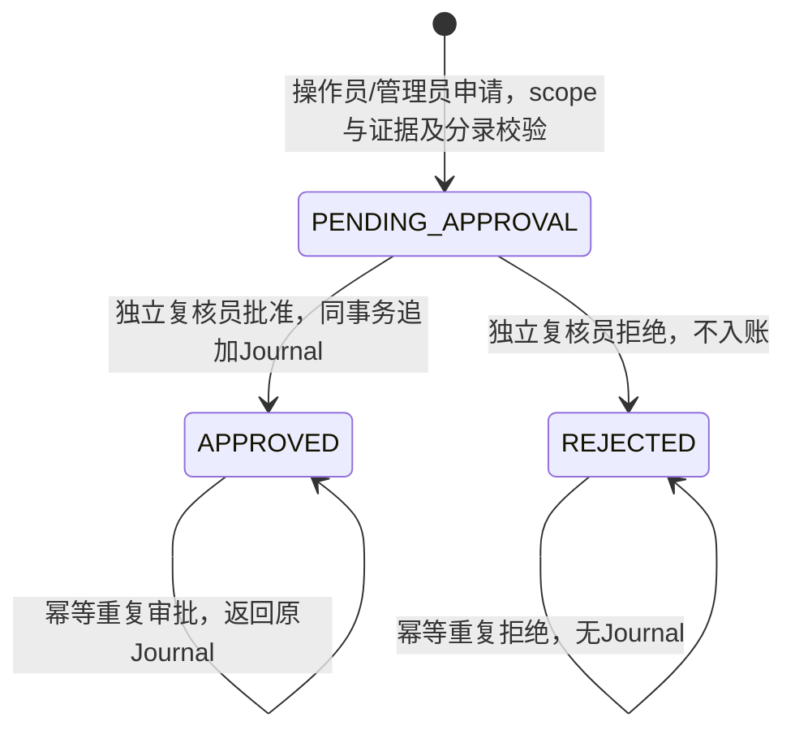

# 人工调整与独立审批

申请创建本身不产生财务效果。请求作者与审批者不得相同，即使该作者后来取得复核角色；OPS_ADMIN 不拥有审批权限。审批锁住申请行后完成条件更新，并通过唯一的 LedgerPostingService 过账。任一失败回滚全部业务效果，失败审计独立保存。

最终状态及批准凭证引用不可修改。相反的终态决定必须被拒绝，不能用重复审批覆盖原决定。后续修正使用新的有证据申请与追加凭证，不改原账。

运营差错动作与[不可变对账报告](reconciliation.md)分别记录：RESOLVE 代表运营处理结果，不能把历史残差或检查结果改成 PASS。运行要求见[运营手册](../runbook/ops.md)。
