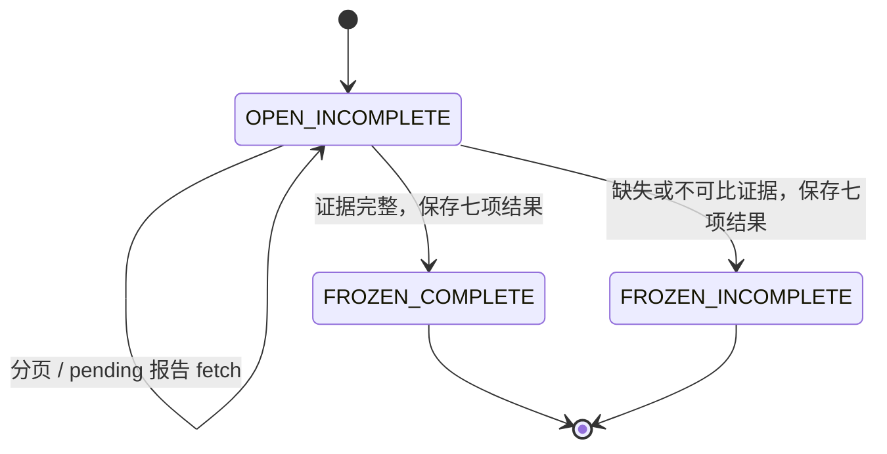

# 对账报告与 L3 任务

报告创建为 INCOMPLETE，import_window/import_cursor 保存分页进度，reconciliation_cursor 固定本 run 的镜像与 API 版本。`advance` 有界推进；页链或范围缺失保持 INCOMPLETE。

COMPLETE 是证据状态；七项结果各自为 PASS、FAIL、INCOMPLETE。冻结后所有报告输入和结果不可改写。晚到事实通过新 run 形成新版本。

L3 使用既有 recovery_task：READY/WAITING → RUNNING（token + version + lease）→ DONE、WAITING 或 ESCALATED。过期租约可由新 owner 领取，旧 token 不能提交。网络读失败 WAITING；无可信订单或冲突 ESCALATED；成功关联及来源证据原子提交。报告冻结不会终止任务，重试只追加操作观察，不改变旧报告异常。

来源 proof、order binding 和 payment provenance 均不可变且带 scoped FK；只有可信订单、完整成功 capture 和当前资格成立时才能回补及历史履约。异常不能通过制造订单或平账 Journal 消除。
